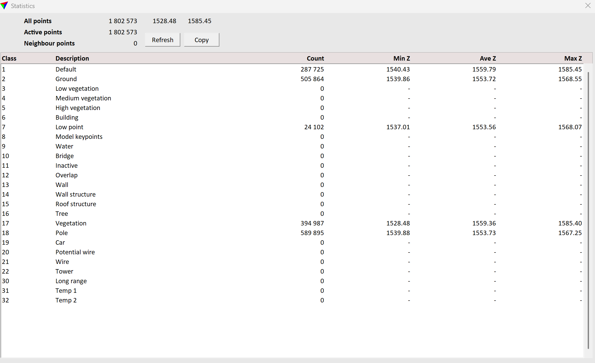
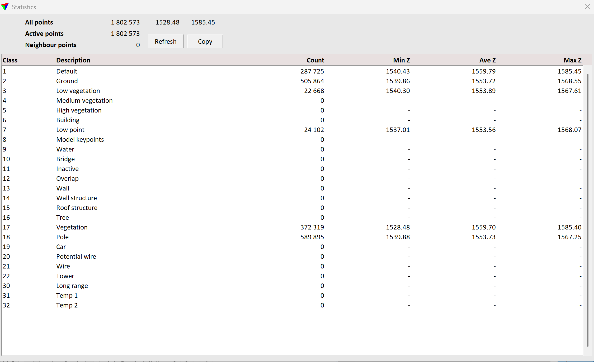
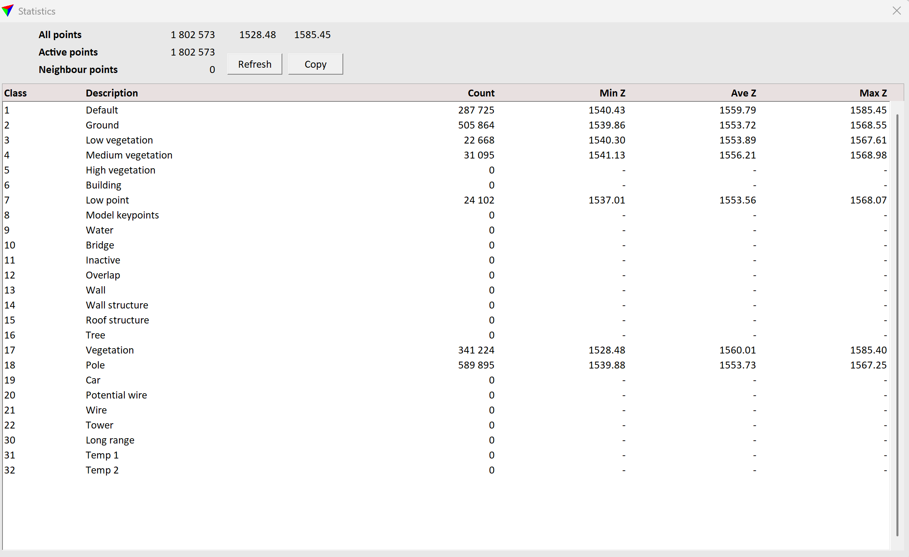
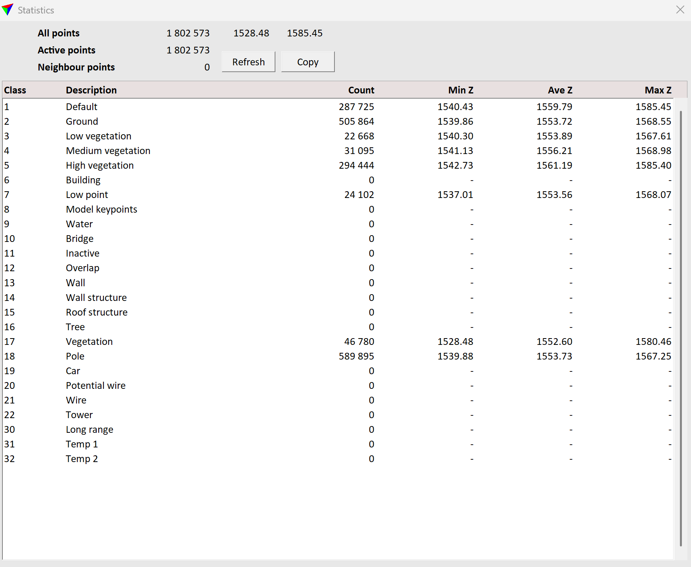
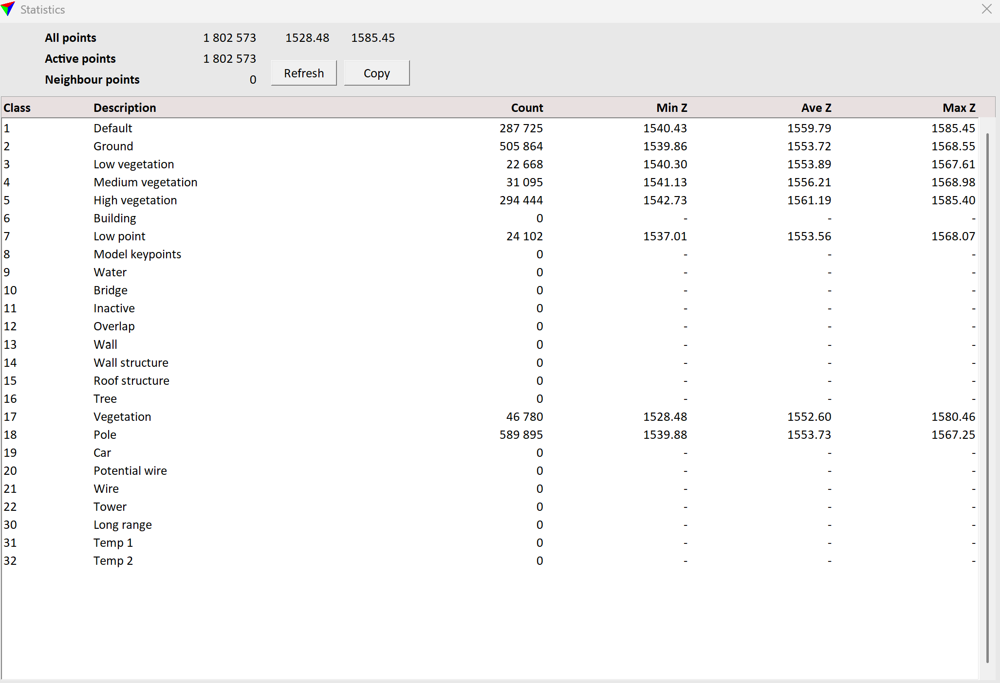
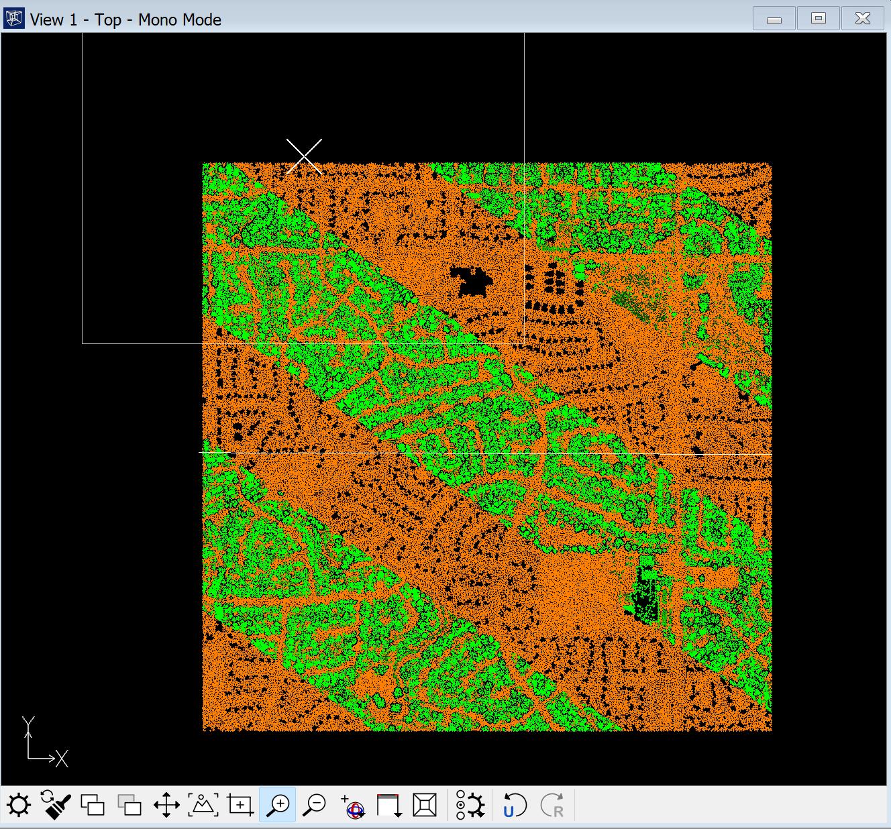
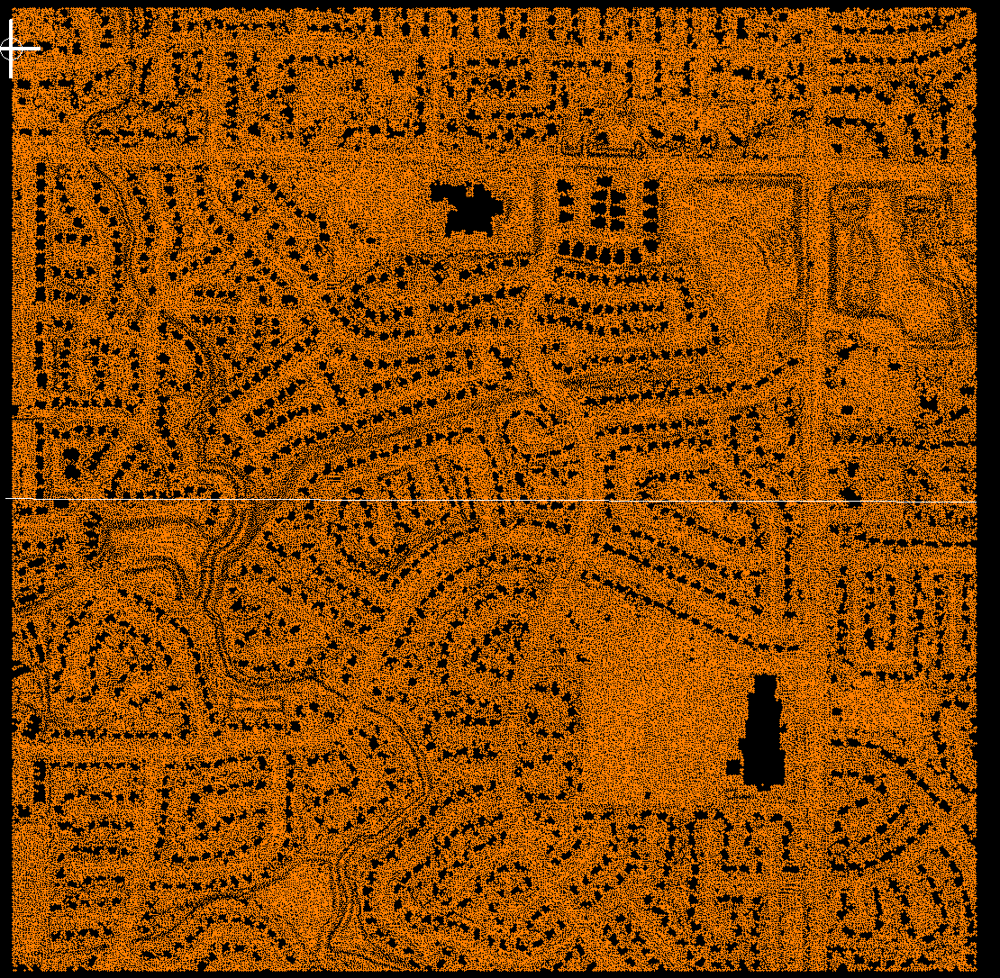
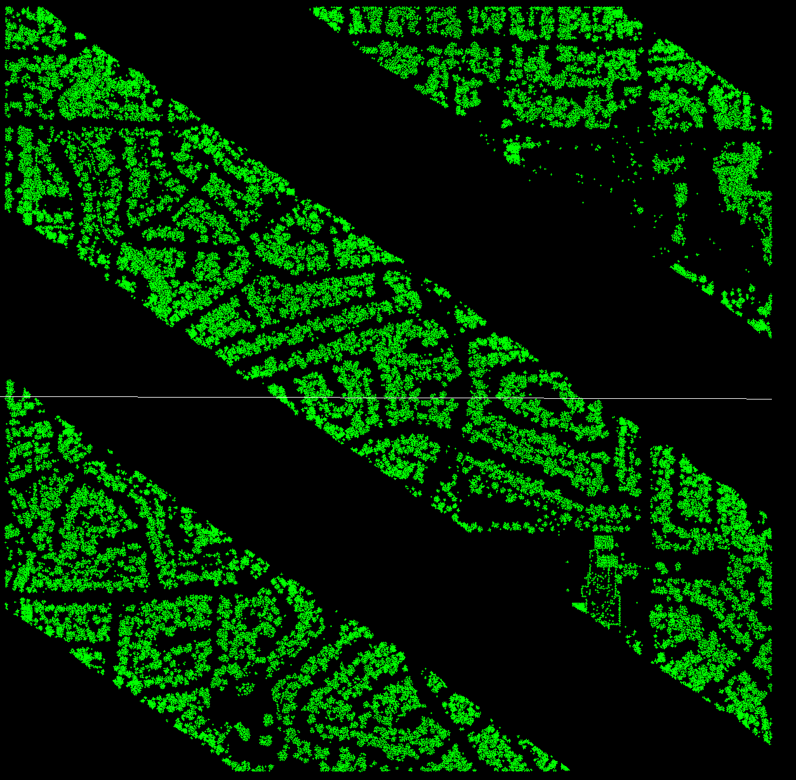
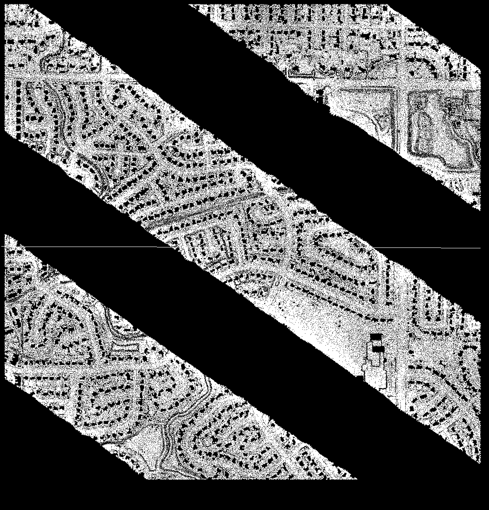

# South Platte LiDAR QA/QC – TerraScan

## Project Overview

This project demonstrates a hands-on **LiDAR point-cloud classification and quality assurance/quality control (QA/QC) workflow** using **TerraScan and Spatix**.

Approximately **1.8 million LiDAR points** from the South Platte River area were processed and evaluated using ground classification, height-from-ground vegetation classification, class statistics, class-based visualization, and visual QA/QC.

The goal of the project was not simply to run automated classification tools. The resulting classes were also evaluated statistically and visually to identify potential classification problems requiring further investigation.

---

## Project Objectives

- Load and inspect a large LiDAR point cloud in TerraScan
- Review existing point classifications
- Establish baseline classification statistics
- Refine the existing ground classification
- Classify vegetation using height above ground
- Compare classification statistics before and after processing
- Isolate individual point classes for visual inspection
- Identify potential classification anomalies
- Preserve the original dataset while creating separate working and processed outputs
- Document the workflow for repeatability and portfolio demonstration

---

## Tools & Technologies

- **TerraScan**
- **Spatix**
- **LiDAR / Point Cloud Data**
- **LAS / LAZ**
- **Point Classification**
- **Ground Classification**
- **Height-From-Ground Analysis**
- **Visual QA/QC**
- **Classification Statistics**
- **Geospatial Data Analysis**

---

## Dataset

The project uses publicly available LiDAR data associated with the **South Platte River area**.

### Total Points Analyzed

**1,802,573 points**

The original source data was preserved separately before classification changes were made.

A separate TerraScan working copy was created so classification experiments could be performed without modifying the original source dataset.

---

# Workflow

## 1. Initial Point Cloud Review

The LiDAR dataset was loaded into **TerraScan through Spatix** and visually inspected.

TerraScan's classification statistics were used to establish a baseline before additional processing.

Initial populated classes included:

| Class | Description | Initial Point Count |
|---|---|---:|
| 1 | Default | 418,851 |
| 2 | Ground | 374,738 |
| 7 | Low Point | 24,102 |
| 17 | Vegetation | 394,987 |
| 18 | Pole | 589,895 |

Classes such as Building, Low Vegetation, Medium Vegetation, and High Vegetation initially contained no points.

### Initial Classification Statistics


---

## 2. Ground Classification

The existing **Class 2 – Ground** points were used as the ground reference.

TerraScan's ground-classification routine evaluated points from **Class 1 – Default** and identified additional points that fit the terrain model.

### Ground Classification Results

Before processing:

**374,738 Ground points**

After processing:

**505,864 Ground points**

A total of:

**131,126 additional points**

were reclassified from Default to Ground.

The total point count remained unchanged, confirming that points were reclassified rather than created or deleted.

### Ground Classification Statistics



---

## 3. Height-From-Ground Vegetation Classification

After refining the ground surface, TerraScan's **By Height From Ground** classification tool was used to separate the existing generic Vegetation class into height-based categories.

The classified ground surface served as the vertical reference.

### Low Vegetation

Vegetation points approximately:

**0.15 – 0.50 meters above ground**

were classified as:

**Class 3 – Low Vegetation**

Result:

**22,668 points**



---

## 4. Medium Vegetation

Remaining vegetation points approximately:

**0.50 – 2.00 meters above ground**

were classified as:

**Class 4 – Medium Vegetation**

Result:

**31,095 points**



---

## 5. High Vegetation

Remaining vegetation points approximately:

**2.00 – 50.00 meters above ground**

were classified as:

**Class 5 – High Vegetation**

Result:

**294,444 points**



---

# Classification Results

After the classification workflow, the point cloud contained:

| Class | Description | Final Point Count |
|---|---|---:|
| 1 | Default | 287,725 |
| 2 | Ground | 505,864 |
| 3 | Low Vegetation | 22,668 |
| 4 | Medium Vegetation | 31,095 |
| 5 | High Vegetation | 294,444 |
| 7 | Low Point | 24,102 |
| 17 | Vegetation | 46,780 |
| 18 | Pole | 589,895 |
| **Total** |  | **1,802,573** |

The final total matched the original point count, providing an additional validation check that the workflow reclassified existing points rather than changing the size of the dataset.

### Final Classification Statistics



---

# Visual QA/QC

Automated classification was **not assumed to be correct simply because the processing completed successfully**.

Individual classes were isolated and visually inspected for spatial consistency.

Ground, Low Vegetation, Medium Vegetation, and High Vegetation were displayed using class-based colors to examine how the classifications were distributed across the point cloud.

### Ground and Vegetation Classification



---

## Ground Class QA

The Ground class was isolated to evaluate the continuity of the terrain classification.

The ground points produced a relatively coherent representation of terrain and roadway surfaces across the project area.



---

## High Vegetation QA

The High Vegetation class was isolated separately.

Visual inspection revealed noticeable spatial patterns and acquisition-style bands within the classified points.

This demonstrated why automated height-based classification should be followed by visual QA/QC rather than accepted solely from point counts.



---

# Classification Anomaly Investigation

One of the most significant QA/QC findings involved:

## Class 18 – Pole

TerraScan reported:

**589,895 points**

assigned to Class 18.

This represents approximately:

**32.7% of the entire point cloud.**

That point count appeared unusually large for a class expected to represent discrete pole features.

Rather than assuming the classification was valid, Class 18 was isolated and visually inspected.

### Class 18 Spatial Distribution


The isolated points extended across broad portions of the project area and followed large spatial/acquisition patterns rather than appearing only as isolated vertical pole features.

A second inspection view reinforced the finding.



### QA/QC Finding

The Class 18 population was therefore flagged as a:

**Suspected classification anomaly requiring additional investigation or reclassification.**

The class was **not automatically modified simply to produce a cleaner visual result**.

Further analysis would be required to determine the intended source classification scheme and the appropriate destination class before modifying those points.

---

# Key QA/QC Principle

This project reinforced an important principle of LiDAR processing:

> **Automated classification results should be validated using both statistical analysis and visual inspection before being accepted as final.**

A processing routine completing successfully does not guarantee that every resulting classification is correct.

Classification statistics can identify unusual point populations, while visual inspection can reveal spatial patterns that may indicate classification errors, acquisition artifacts, or inconsistencies in the source data.

---

# Project Results

This project demonstrated hands-on experience with:

- Loading and inspecting LiDAR point-cloud data
- Working with approximately 1.8 million LiDAR points
- TerraScan point classification
- Ground classification
- Height-from-ground analysis
- Low vegetation classification
- Medium vegetation classification
- High vegetation classification
- LAS/LAZ point classes
- Point-class statistics
- Class-based visualization
- Visual LiDAR QA/QC
- Classification validation
- Identification of suspected classification anomalies
- Preservation of source data
- Export of processed LiDAR data
- Technical documentation of geospatial processing results

---

# Repository Structure

```text
TerraScan-LiDAR-QAQC/
│
├── Data/
│   └── Local LiDAR source/working data
│
├── Documentation/
│   └── Supporting project documentation
│
├── Outputs/
│   └── Processed LiDAR outputs
│
├── Screenshots/
│   ├── Classification statistics
│   ├── Ground classification results
│   ├── Vegetation classification results
│   └── QA/QC investigation screenshots
│
├── South_Platte_LiDAR_Project.spx
├── .gitignore
└── README.md
```

Large `.LAS`, `.LAZ`, and TerraScan binary files are excluded from GitHub using `.gitignore`.

---

# QA/QC Methodology

The project followed a basic QA/QC cycle:

```text
Load Point Cloud
       ↓
Review Existing Classes
       ↓
Record Baseline Statistics
       ↓
Ground Classification
       ↓
Validate Point Counts
       ↓
Height-From-Ground Classification
       ↓
Low / Medium / High Vegetation
       ↓
Review Updated Statistics
       ↓
Isolate Individual Classes
       ↓
Visual QA/QC
       ↓
Identify Classification Anomalies
       ↓
Document Findings
```

---

# Future Improvements

Future iterations of this project could expand the workflow by:

- Performing manual classification corrections
- Investigating the source and intended meaning of Class 18
- Performing additional noise/outlier analysis
- Creating profile and cross-section views for vertical QA/QC
- Testing alternative ground-classification parameters
- Comparing classification results against imagery
- Building repeatable TerraScan macros
- Performing tile-by-tile QA/QC
- Developing a formal LiDAR QA checklist
- Comparing pre-classification and post-classification results across multiple areas of interest

---

# Skills Demonstrated

**LiDAR • TerraScan • Spatix • Point Cloud Processing • LAS/LAZ • Ground Classification • Vegetation Classification • Height-From-Ground Analysis • Classification Statistics • QA/QC • Remote Sensing • Geospatial Analysis • Data Validation • Technical Documentation**

---

## Project Status

**Version 1 – Complete**

The initial TerraScan classification and QA/QC workflow is complete.

The project successfully demonstrates both automated LiDAR processing and the more important QA/QC process of **evaluating, questioning, and documenting classification results rather than automatically accepting them.**
